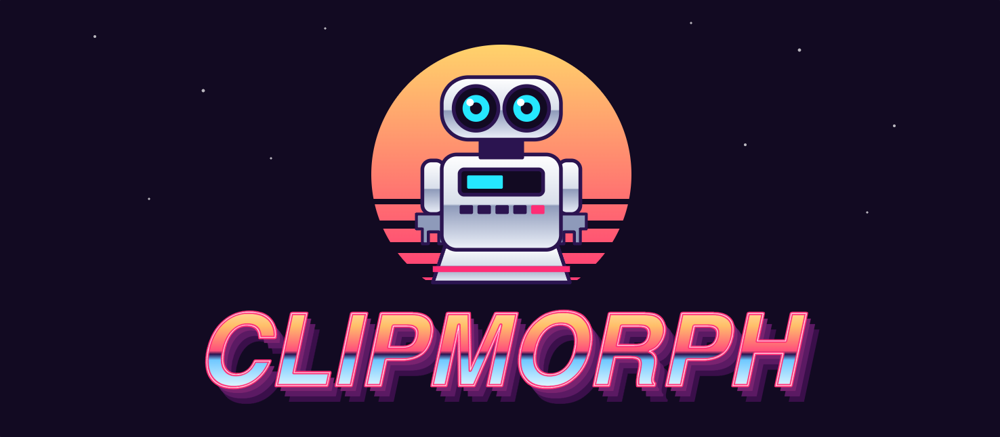

<p align="center">
  
</p>

<p align="center">
  A macOS menu-bar app that transforms your clipboard with AI.<br>
  Copy text, press <b>⌥Space</b>, pick a recipe, and the result streams back onto your clipboard.
</p>

<p align="center">
  
  
</p>

## Install

1. Download **Clipmorph.zip** from the [latest release](https://github.com/nicop-hd/Clipmorph/releases/latest).
2. Unzip it and drag **Clipmorph.app** into your **Applications** folder.
3. Open it. Because the app isn't notarized by Apple yet, macOS will block it the first time. Go to **System Settings → Privacy & Security**, scroll down and click **Open Anyway**. Or run this once in Terminal:

   ```bash
   xattr -dr com.apple.quarantine /Applications/Clipmorph.app
   ```

Clipmorph lives in the menu bar (no Dock icon). Runs on Apple Silicon and Intel Macs with macOS 14 or later.

## Build from source

```bash
./scripts/build-app.sh
open build/Clipmorph.app
```

Requires macOS 14+ and the Swift toolchain (Command Line Tools are enough). On first launch, Settings opens: paste a Claude or OpenAI API key (stored in the login Keychain).

## Using it

| Key | Action |
|---|---|
| ⌥Space | Open / close the panel |
| 1–9 or ↑↓ ⏎ | Run a recipe |
| ⏎ (after result) | Close (and paste into the previous app if auto-paste is on) |
| ⌫ | Back to recipes |
| esc | Close |

Auto-paste needs Accessibility permission. Results are copied to the clipboard regardless.

## Custom recipes

Settings → **Open Recipes File** creates `~/Library/Application Support/Clipmorph/recipes.json`:

```json
[{ "id": "commit-message", "name": "Commit message", "icon": "arrow.triangle.branch",
   "prompt": "Write a conventional git commit message for this diff." }]
```

`icon` is an SF Symbol name. Changes are picked up the next time the panel opens.

## Layout

- `AppDelegate.swift`: menu-bar item, hotkey, settings window
- `PanelController.swift` / `PanelView.swift`: floating non-activating panel and keyboard handling
- `TransformModel.swift`: run state and streaming into the panel
- `LLMClient.swift`: Claude Messages API and OpenAI Chat Completions over SSE
- `Recipes.swift`: built-in recipes, custom recipe loading, prompt template
- `Settings.swift` / `Keychain.swift`: preferences and API key storage
